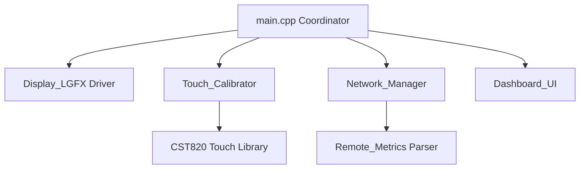

# ESP32 Touchscreen PZEM-004T Dashboard

A high-performance, modular metrics dashboard for ESP32 designed to display real-time sensor information (Voltage, Current, Energy, Power) retrieved from local HTTP Prometheus endpoints (such as ESPHome or Home Assistant devices).

The display driver is powered by **LovyanGFX** interfacing with an **ST7789** controller over a high-speed parallel bus, with **LVGL v8.3.11** serving as the graphical user interface framework.

---

## Key Features

* **Layered Modular Architecture**: Decoupled design separating UI rendering (`Dashboard_UI`), pure hardware-independent logic (`Metrics_Parser`, `Metrics_Stats`, `Network_Store`, `Touch_Math`, `UI_Logic`), background networking (`Network_Manager`), and low-level driver implementations.
* **Core-0 Non-Blocking Networking & Asynchronous Scan**: Wi-Fi cycling, explicit connect requests, async network scanning (`WiFi.scanNetworks(true)`), and Prometheus HTTP polling run in a Core-0 FreeRTOS task (`network_task`), keeping Core 1 responsive from boot without RGB flash delays or UI freezes.
* **8-Metric Prometheus Telemetry & Dynamic Target Config**: Parses Voltage, Current, Power, Energy, Frequency (`Hz`), Power Factor (`PF`), Temperature (`°C`), and Humidity (`%`) with strict validation (`--` before first valid fetch instead of `0.00`). Endpoint IP and Path are configurable in Settings and persisted via NVS.
* **Floating Top-50px HUD & Multi-Theme Support**: Preserves full 2×2 card touch height with a floating top-left freshness/RSSI/diagnostics pill, top-center DHT22 ambient pill, and top-right Brightness/Settings controls. Supports **Primitive** (default) and **Dark High Contrast** themes.
* **Zoom Sparklines, Threshold Alerts & Session Cost**: Tapping any card opens a detail view with a 60-sample `lv_chart` sparkline and `Min / Avg / Max` stats. Configurable Voltage (`<95V` / `>127V`), Current (`>10A`), and dynamic Power (`V × I_max`) thresholds highlight card borders; Energy tracks session kWh and estimated tariff cost with an instant **Reset Session** action.
* **Unified Persistent Keyboard & Ergonomics**: 160px global `lv_keyboard` on `lv_layer_top()` with automatic IP/numeric keymap (`LV_KEYBOARD_MODE_USER_1`) and scroll-into-view when inputs are focused.
* **Hardware PWM Brightness & Inactivity Auto-Dim**: Smooth PWM slider with click-out cancel plus configurable Auto-Dim (`Off`–`10 min`) that restores brightness on first tap while absorbing the wake press.
* **4-Point Least-Squares Touch Calibration, Reset & Cursor Toggle**: Solves a 4-point affine matrix with residual checks to NVS, adds instant **Reset TS Calib** (no reboot), and provides a live Settings switch for the Red Touch Dot (default ON).

---

## Architecture Overview

### Component Structure
* **`SPEC.md` & `specs/*.md`**: Canonical specifications for architecture, NVS schemas, Prometheus metrics, touch math, and 320×240 UI behavior.
* **`src/main.cpp`**: Main entry point coordinating hardware initialization, touch sampling with `AutoDimController`, applying brightness, and driving the LVGL loop.
* **`include/Display_LGFX.h` / `src/Display_LGFX.cpp`**: LovyanGFX display configuration for the ST7789 panel running on an 8-bit parallel bus, including `Light_PWM` backlight control.
* **`include/Touch_Math.h` / `src/Touch_Math.cpp`**: Hardware-independent 4-point least-squares affine calibration solver and coordinate clamping.
* **`include/Touch_Calibrator.h` / `src/Touch_Calibrator.cpp`**: 4-corner visual calibration utility, instant `resetTouchCalibration()`, and NVS storage manager.
* **`include/Network_Store.h` / `src/Network_Store.cpp`**: Hardware-independent Wi-Fi credential priority list serialization and URL normalization.
* **`include/Network_Manager.h` / `src/Network_Manager.cpp`**: Core-0 non-blocking Wi-Fi cycling, async Wi-Fi scan, HTTP polling task, and NVS application settings persistence.
* **`include/Metrics_Parser.h` / `src/Metrics_Parser.cpp`**: Hardware-independent 8-metric Prometheus text exposition parser.
* **`include/Metrics_Stats.h` / `src/Metrics_Stats.cpp`**: 60-sample ring buffer statistics, stale detection, alert evaluators, and session energy/tariff calculations.
* **`include/Remote_Metrics.h` / `src/Remote_Metrics.cpp`**: Arduino/ESP32 HTTP client wrapper around `Metrics_Parser`.
* **`include/UI_Logic.h` / `src/UI_Logic.cpp`**: Pure theme palettes, HUD freshness/RSSI bar helpers, `lv_chart` scaling, alert styles, and `AutoDimController`.
* **`include/Dashboard_UI.h` / `src/Dashboard_UI.cpp`**: LVGL UI layout creating the 2×2 cards, floating HUD, themed Zoom sparkline modals, async scan/connect modals, and Settings/Brightness overlays.
* **`test/`**: PlatformIO `[env:native]` Unity regression test suites covering `Metrics_Parser`, `Metrics_Stats`, `Network_Store`, `Touch_Math`, and `UI_Logic`.
* **`lib/CST820/`**: Statically isolated private PlatformIO driver library for the CST820 touchpad controller.

---

## Hardware Configuration & Pin Map

### ST7789 MCU8080 8-Bit Parallel Display
| Signal | ESP32 GPIO | Description |
|--------|------------|-------------|
| `WR`   | GPIO 4     | Write Clock |
| `RD`   | GPIO 2     | Read Clock |
| `RS`   | GPIO 16    | Register Select (DC) |
| `CS`   | GPIO 17    | Chip Select |
| `RST`  | Unused     | Hardware Reset |
| `BLK`  | GPIO 0     | PWM Backlight Control |
| `D0`   | GPIO 15    | Data Bit 0 |
| `D1`   | GPIO 13    | Data Bit 1 |
| `D2`   | GPIO 12    | Data Bit 2 |
| `D3`   | GPIO 14    | Data Bit 3 |
| `D4`   | GPIO 27    | Data Bit 4 |
| `D5`   | GPIO 25    | Data Bit 5 |
| `D6`   | GPIO 33    | Data Bit 6 |
| `D7`   | GPIO 32    | Data Bit 7 |

### CST820 Capacitive Touch Controller (I2C)
| Signal | ESP32 GPIO | Description |
|--------|------------|-------------|
| `SDA`  | GPIO 21    | I2C Data Line |
| `SCL`  | GPIO 22    | I2C Clock Line |
| `RST`  | Unused     | Reset Pin |
| `INT`  | Unused     | Interrupt Pin |

### Official Board Documentation
For deeper hardware details, schematics, and component datasheets provided by the vendor (Sunton), refer to the files included in the `docs/` directory:
* **Board Schematics & Specs**: `ESP32-2432S022 Specifications-EN.pdf`, `ESP32-2432022-LCM-V1.0.png`, `ESP32-2432022-MCU-V1.0.png`, `Dimensions.jpg`
* **Core Components**: `ESP32-WROOM-32.PDF`, `ESP32-WROOM-1 Pin definition.png`, `25Q32JVSSIQ.PDF` (Flash), `FM8002A.PDF` (Audio Amp)
* **Touch Controller**: `CST820 数据手册V1.1.pdf` (CST820 Datasheet)
* **Quick Start**: `Getting started 2.2.pdf`

---

## Installation & Setup

1. **Prerequisites**: Install [VSCode](https://code.visualstudio.com/) and the [PlatformIO IDE](https://platformio.org/) extension.
2. **Initial Boot Configuration**: On first boot, there are no saved networks or metrics configuration. Open the settings screen using the UI gear icon to scan/add a Wi-Fi network and input your target Prometheus metrics server IP and path (defaults to `/metrics`).
3. **Partition Table**: Since the project integrates LVGL fonts, the binary size exceeds the standard 1.2MB partition. The [platformio.ini](file:///c:/Users/marco/Documentos/PlatformIO/Projects/esp32_touchscreen/platformio.ini) is configured with `board_build.partitions = huge_app.csv` to allocate **3.0 MB** for the program, ensuring compilation succeeds out-of-the-box.

---

## Compilation & Flashing

Use PlatformIO shortcut commands in VSCode to build and deploy:
* **Build**: `ctrl` + `alt` + `b`
* **Upload**: `ctrl` + `alt` + `u`
* **Monitor**: `ctrl` + `alt` + `s` (Set to `115200` baud)
